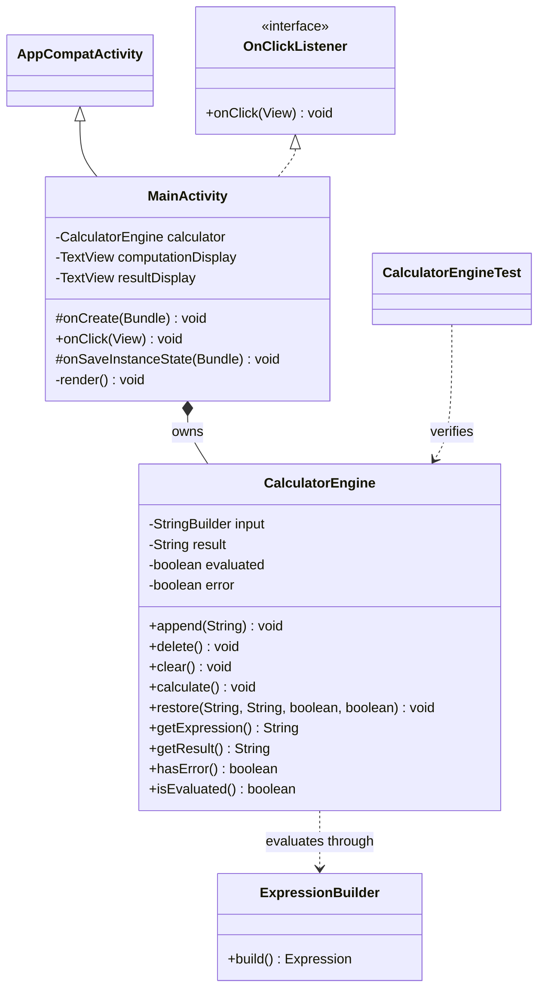
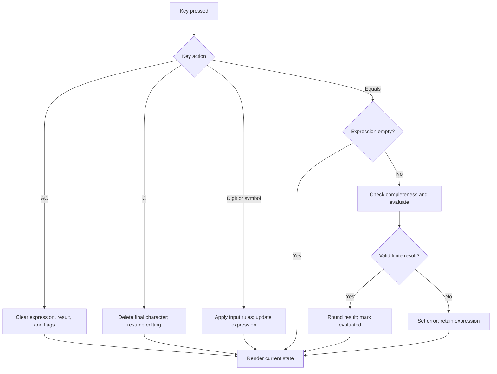

# Design and Implementation of an Android Calculator

**Daniel Tongu**

CS460 — Software Engineering for Mobile Devices

## Abstract

This project implements a single-screen Android calculator using Java and XML. It supports basic arithmetic, decimal operands, negative numbers, parentheses, character deletion, and continuation from previous results. An Android-independent calculation engine separates expression handling from screen rendering. The interface uses a dark theme, grouped keypad colors, and scalable result text. This report describes the requirements, architecture, calculation flow, implementation, build procedure, and verification status.

**Index Terms—**Android, calculator, Java, expression evaluation, software testing.

## I. Introduction

The objective is to develop a usable calculator while demonstrating event handling, interface design, input validation, and separation of responsibilities. The application uses package name `com.example.calculator`, supports Android API 24 and later, and currently compiles against and targets API 34.

The project uses the Gradle wrapper and Android Gradle Plugin (AGP) to build the Android application. The calculation engine itself has no dependency on Android views or lifecycle classes.

## II. Software Requirements

| ID | Requirement | Implementation |
|---|---|---|
| FR-01 | Accept digits and decimal operands | Keys `0–9` and `.`; duplicate decimal separators are ignored within a number. |
| FR-02 | Support basic arithmetic | Addition, subtraction, multiplication, and division with operator precedence. |
| FR-03 | Support grouped expressions | Opening and closing parentheses; adjacent operands and parentheses imply multiplication. |
| FR-04 | Display the evaluated result | The `=` key evaluates a complete expression. |
| FR-05 | Clear all calculation state | `AC` empties the expression, resets the result to `0`, and clears flags. |
| FR-06 | Delete recent input | `C` removes the final expression character. |
| FR-07 | Recover from invalid calculations | Display an error while retaining the expression for editing. |
| FR-08 | Continue calculations | An operator after a result continues from it; a digit starts a new expression. |
| FR-09 | Restore interrupted state | Save and restore expression, result, and flags during activity recreation. |

| ID | Interface or quality requirement | Implementation |
|---|---|---|
| QR-01 | Distinguish keypad groups | All digits use orange `#FF8033`; `AC` uses pink `#FF3377`; `C` uses blue `#337DFF`. |
| QR-02 | Provide readable labels | Most key labels use 36sp; `AC` uses 30sp; the expression uses 36sp. |
| QR-03 | Accommodate short screens | A scrollable layout keeps the keypad reachable. |
| QR-04 | Support accessible interaction | Function keys have descriptive labels; result changes use a polite accessibility live region. |
| QR-05 | Permit independent logic testing | `CalculatorEngine` can be tested without launching Android. |

The shared orange styling for all digits is an approved design adjustment to the original requirement that highlighted only `0`.

## III. System Design

### A. Component Responsibilities

| Component | Responsibility |
|---|---|
| `MainActivity.java` | Connect keypad events, render displays, and save or restore state. |
| `CalculatorEngine.java` | Maintain expression state, validate input, evaluate expressions, and format results. |
| `activity_main.xml` | Arrange the expression, result, and twenty keypad buttons. |
| `styles.xml`, `colors.xml`, and `themes.xml` | Define shared button geometry, colors, typography, and system-bar appearance. |
| `strings.xml` | Store application labels, accessibility descriptions, and error text. |
| `CalculatorEngineTest.java` | Exercise arithmetic and input-state transitions. |

### B. UML Class Diagram

The diagram summarizes application classes and their principal relationships. External Android and library classes are included only where they explain inheritance or evaluation.



### C. Keypad and Calculation Flow

Every button event is routed through `MainActivity.onClick()`. The engine changes state, and the activity renders the resulting expression and result.



### D. State Restoration

Before activity destruction, `onSaveInstanceState()` stores four values in a `Bundle`: expression, result, evaluated flag, and error flag. During creation, `onCreate()` restores those values through `CalculatorEngine.restore()` before rendering. Saved instance state supports system-managed recreation; it is not permanent calculation history [1].

## IV. Implementation

### A. Input Processing

The keypad supplies single-character tokens. The engine accepts digits, decimal points, four arithmetic operators, and parentheses. A pending binary operator can be replaced. Unary minus is supported at the beginning of an expression and in supported operand positions, such as `2*-3`.

Decimal input receives a leading zero when needed. Unmatched closing parentheses are ignored. Entering `2(3+4)` inserts multiplication internally, producing `2*(3+4)`. The engine reserves space for inserted characters within its 256-character input bound.

### B. Evaluation and Formatting

The application uses `exp4j` version 0.4.8 through `ExpressionBuilder`. Evaluation occurs when the user presses `=`. The engine rejects incomplete expressions, unmatched opening parentheses, and non-finite results. Expected expression and arithmetic exceptions set the error flag rather than terminating the activity.

Evaluation uses Java `double` arithmetic. Results are converted to `BigDecimal` and rounded to twelve significant digits for display. Ordinary values use plain notation; values outside the formatting thresholds use scientific notation. Continued calculations use the formatted result, so rounding affects subsequent operations. This implementation does not provide exact decimal arithmetic.

### C. Interface

The screen places the expression above a larger result and the keypad below the display. All digits share one orange style. Arithmetic operators use a subdued background and accent text; equals uses an accent background. Clear controls retain their required colors.

The shared key style removes theme-dependent insets and keeps labels on one line. The result automatically adjusts between 18sp and 90sp. Long expressions remain on one line and are ellipsized at the beginning. A `ScrollView` allows access to controls when vertical space is limited.

## V. Build and Execution

| Setting | Configured value |
|---|---|
| Language and interface | Java 17 and XML |
| Android Gradle Plugin | 8.13.2 |
| Gradle wrapper | 8.13 |
| Build and compilation JDK | JDK 17 recommended for launch; Java toolchain pinned to 17 |
| Minimum Android SDK | API 24 |
| Compile and target SDK | API 34 |
| Expression library | exp4j 0.4.8 |
| Unit test framework | JUnit 4.13.2 |

AGP 8.13 documents Gradle 8.13, SDK Build Tools 35.0.0, and JDK 17 as its compatibility baseline [2].

Clone the repository if a local checkout is not already available:

```sh
git clone https://github.com/danielTongu/Calculator-Android-App.git
cd Calculator-Android-App
```

1. Open the project root in Android Studio.
2. Install Android SDK Platform 34 and SDK Build Tools 35.0.0 through SDK Manager.
3. Select JDK 17 under **Settings → Build, Execution, Deployment → Build Tools → Gradle → Gradle JDK**.
4. Sync the project and select an API 24 or newer device or emulator.
5. Run the `app` configuration.

For terminal builds, set `JAVA_HOME` to an installed JDK 17 and execute:

```sh
./gradlew testDebugUnitTest assembleDebug lintDebug
```

The debug APK is written to `app/build/outputs/apk/debug/` after a successful build.

On Windows, use `gradlew.bat`. The wrapper selects the project's pinned Gradle distribution. The compilation toolchain does not change the JVM that initially launches Gradle. Upgrade AGP, Gradle, and the build JVM as a compatible combination; assess Android target SDK changes separately.

## VI. Verification and Results

### A. Automated Logic Tests

`CalculatorEngineTest` contains nine JUnit tests [3]. The engine and tests were compiled with JDK 17 and executed directly using cached exp4j and JUnit dependencies. All nine tests passed during the implementation session.

| Test area | Representative case | Expected outcome |
|---|---|---|
| Precedence and grouping | `2+3*4`; `(2+3)*4` | `14`; `20` |
| Clear and delete | Delete `+` from `2+`, then enter `*3` | `6` |
| Decimal handling | `0.1+0.2`; input `.2.3` | `0.3`; expression `0.23` |
| Negative operands | `-2*-3` | `6` |
| Operator replacement and implicit multiplication | `2+*3`; `2(3+4)` | `6`; `14` |
| Error recovery | Evaluate `1/0`, replace `0` with `2` | Error followed by `0.5` |
| Result continuation | `2+3=`, then `*4=`, then `+1=` | `5`, `20`, `21` |
| State restoration | Restore completed `3+4`, then enter `*2=` | `14` |
| Empty and unmatched input | Empty equals; input `)2)` | Result stays `0`; expression becomes `2` |

### B. Resource and Build Checks

Android resource compilation using `aapt2` passed after the interface changes. XML parsing and `git diff --check` also passed. Resource compilation alone does not verify complete resource linking, APK assembly, or runtime behavior.

Full Gradle build and lint execution were attempted but blocked by execution-environment restrictions affecting cache writes and socket creation. Therefore, a successful APK build, lint run, or connected instrumentation run is not claimed here. The existing instrumentation test checks the application package context; it does not verify calculator interactions.

### C. Manual Validation Still Required

| Scenario | Acceptance condition |
|---|---|
| Rotation and activity recreation | Expression, result, and flags remain consistent. |
| Landscape and short screens | Every key remains reachable by scrolling. |
| Large system font settings | Labels remain readable and usable. |
| TalkBack | Function keys are described and result updates are announced. |
| Long expressions and extreme results | Truncation and scientific notation remain understandable. |

## VII. Limitations and Future Work

The calculator does not provide persistent history, scientific functions, or exact decimal evaluation. A trailing decimal separator is treated as an incomplete operand until followed by a digit. Input is bounded, and long expressions may be visually truncated. Display rounding can accumulate across chained calculations.

Future work should prioritize completing device validation and the full build checks, adding interface tests for recreation and accessibility, and expanding tests for input-length boundaries and extreme numerical values. Persistent history or additional operations can then be introduced as separate features.

## VIII. Conclusion

The application implements the required arithmetic and clear functions with a consistent keypad design. Separating the engine from the activity makes calculation behavior independently testable, while saved instance state supports interrupted calculations. Nine passing logic tests and successful resource compilation provide partial verification; full Android build and device checks remain necessary before release.

## References

[1] Google, “Save UI states,” *Android Developers*. [Online]. Available: https://developer.android.com/topic/libraries/architecture/saving-states. Accessed: Nov. 16, 2026.

[2] Google, “Android Gradle Plugin 8.13.0,” *Android Developers*. [Online]. Available: https://developer.android.com/build/releases/agp-8-13-0-release-notes. Accessed: Nov. 16, 2026.

[3] JUnit Team, “JUnit 4—About.” [Online]. Available: https://junit.org/junit4/. Accessed: Nov. 16, 2026.
